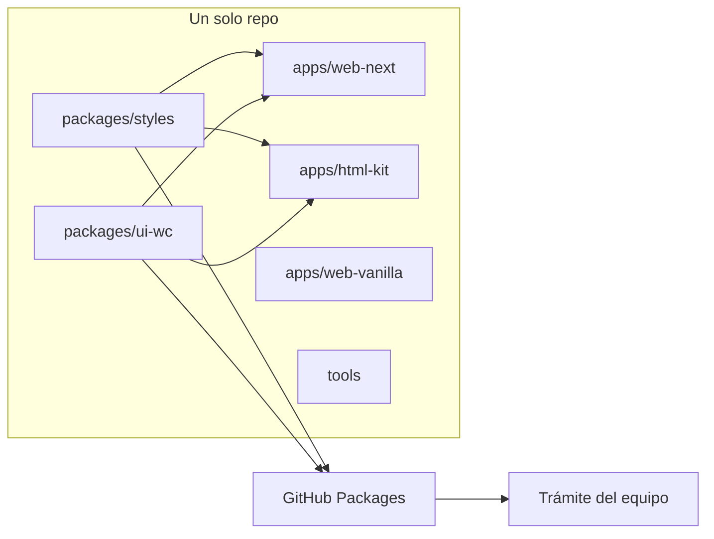
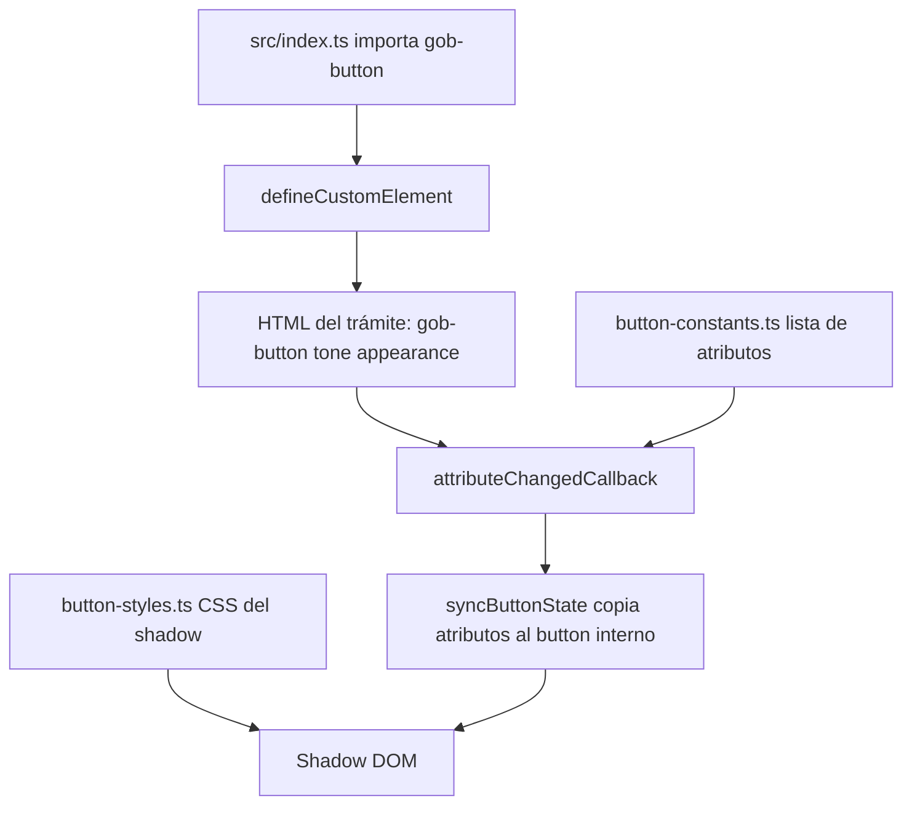
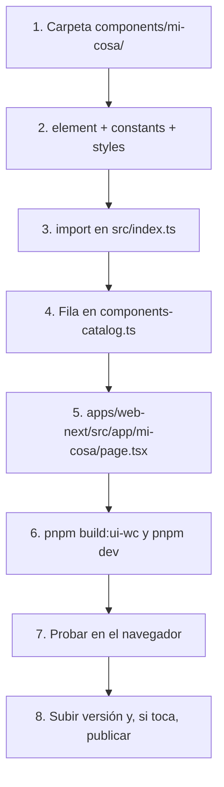
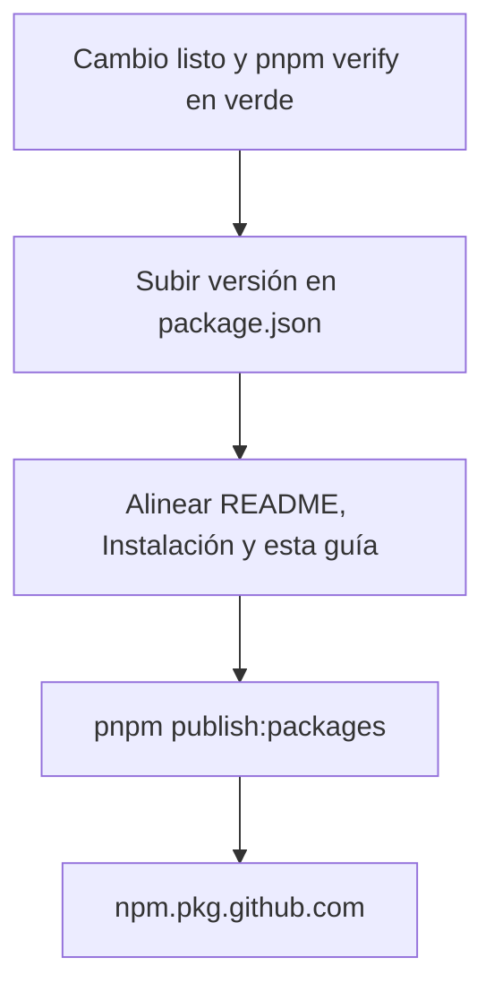

# Gob UI — guía interna para continuar el proyecto

Este archivo es para el equipo: auditoría y para que alguien nuevo (aunque sea junior) entienda el repo y pueda seguir. **No va en el sitio público.** El menú de la demo solo muestra Componentes e Instalación.

Léelo en este orden. No hace falta saberlo todo el primer día.

- [Gob UI — guía interna para continuar el proyecto](#gob-ui--guía-interna-para-continuar-el-proyecto)
  - [1. Qué es, en una frase](#1-qué-es-en-una-frase)
  - [2. Palabras que vas a ver](#2-palabras-que-vas-a-ver)
  - [3.constriccion](#3constriccion)
  - [4. Mapa del repo](#4-mapa-del-repo)
  - [5. Los dos paquetes](#5-los-dos-paquetes)
    - [styles](#styles)
    - [ui-wc](#ui-wc)
  - [6. Cómo se ve un componente por dentro](#6-cómo-se-ve-un-componente-por-dentro)
  - [7. Cómo está hecha una página de la demo](#7-cómo-está-hecha-una-página-de-la-demo)
  - [8. Cómo agregar un componente](#8-cómo-agregar-un-componente)
    - [Paso 1 y 2 — el código](#paso-1-y-2--el-código)
    - [Paso 3 — registro](#paso-3--registro)
    - [Paso 4 y 5 — la demo](#paso-4-y-5--la-demo)
    - [Paso 6 y 7 — verlo](#paso-6-y-7--verlo)
    - [Paso 8 — versión](#paso-8--versión)
  - [9. Reglas que no se negocian](#9-reglas-que-no-se-negocian)
  - [10. Catálogo](#10-catálogo)
  - [11. Publicar](#11-publicar)
  - [12. Qué revisa el CI](#12-qué-revisa-el-ci)
  - [13. Errores frecuentes](#13-errores-frecuentes)
  - [14. Qué puedes tocar y qué no](#14-qué-puedes-tocar-y-qué-no)

Datos vigentes al escribir esto:

| Dato | Valor |
| --- | --- |
| Repo | `mariasan001/dgp_liberia` |
| Estilos | `@mariasan001/styles` **0.1.4** |
| Componentes | `@mariasan001/ui-wc` **0.3.1** |
| Gestor | pnpm **9.12.3** |
| Demo | http://localhost:9090 |
| Registro npm | `https://npm.pkg.github.com` |

Si publicas una versión nueva, actualiza esta tabla, el `README.md` y las constantes `STYLES_VERSION` / `UI_VERSION` en `apps/web-next/src/app/instalacion/page.tsx`.

---

## 1. Qué es, en una frase

Gob UI es una librería de interfaz para trámites. El equipo que la usa escribe HTML con etiquetas propias (`gob-button`, `gob-input`, `gob-alert`…) y carga cuatro archivos CSS.

No es una app de React. React y Next solo sirven para **mostrar** la documentación y, si alguien quiere, para hospedar las mismas etiquetas. La API pública es el HTML: atributos y slots.

Siempre son **dos paquetes**:

| Paquete | Qué aporta | Si falta |
| --- | --- | --- |
| `@mariasan001/styles` | Tipografía, colores, espacios, clases de layout | Se ven las etiquetas, pero feas o sin marca |
| `@mariasan001/ui-wc` | El JavaScript que registra cada `gob-*` | El navegador enseña las etiquetas vacías, sin comportamiento |

---

## 2. Palabras que vas a ver

| Palabra | Significado aquí |
| --- | --- |
| Monorepo | Un solo repositorio con varias carpetas (apps y paquetes) que se instalan juntas con pnpm. |
| Paquete | Lo que se publica en npm. Aquí solo `styles` y `ui-wc`. Las apps no se publican. |
| Workspace | PnPm enlaza los paquetes locales con `"@mariasan001/ui-wc": "workspace:*"` en la demo. No baja la versión de GitHub mientras desarrollas. |
| Web Component | Etiqueta HTML inventada por nosotros. El navegador la reconoce después de cargar el JS. |
| Custom Element | Lo mismo: la clase JavaScript registrada con `customElements.define('gob-button', …)`. |
| Shadow DOM | Un HTML y un CSS privados dentro de la etiqueta. El CSS de la página no le entra, y el de adentro no se sale. Por eso los colores van en variables `--gob-*` (esas sí cruzan el shadow). |
| Token | Una variable de diseño, por ejemplo `--gob-primary: #9f2141`. No es el token de GitHub. |
| Token de GitHub | Una clave `ghp_…` para que npm pueda bajar paquetes. Va en `.npmrc`. No se sube al repo. |
| Slot | Hueco dentro del componente donde el HTML de afuera mete contenido. Ejemplo: `<span slot="icon">`. |
| Atributo | Lo que escribes en la etiqueta: `tone="primary"`, `disabled`, `loading`. |
| tsup | Herramienta que convierte el TypeScript de `ui-wc` en un solo `dist/index.js` más los tipos `.d.ts`. |
| Demo / sitio | `apps/web-next`. Catálogo e instalación. Puerto 9090. |
| Kit | `apps/html-kit`. Un CSS y un JS ya armados, por si no se usa npm. No es el camino principal del equipo. |

---

## 3.constriccion

Necesitas Node.js 20 o superior y pnpm 9. Si `pnpm` no existe:

```bash
corepack enable
corepack prepare pnpm@9.12.3 --activate
```

En la raíz del repo (`gob-ui-v2-nuevo` / `dgp_liberia`):

```bash
pnpm install
pnpm build:ui-wc
pnpm dev
```

Abre http://localhost:9090.

- **Componentes**: catálogo. Entra a Botones y mira cómo se documenta un componente. Esa página es la referencia de layout; el comentario al inicio de `apps/web-next/src/app/botones/page.tsx` dice que no se le cambia el cascarón.
- **Instalación**: lo que ve quien va a usar la librería en un trámite (token, `.npmrc`, install, HTML).

`pnpm build:ui-wc` es obligatorio la primera vez. La demo importa `@mariasan001/ui-wc`, y ese paquete apunta a `packages/ui-wc/dist`. Si `dist` no existe, Next falla.

Para comprobar que no rompiste nada:

```bash
pnpm verify
```

Eso corre lint, tipos, build de Next y un empaquetado en seco. Tarda. Es lo mismo que pide el CI.

---

## 4. Mapa del repo



| Carpeta | ¿Se publica? | Qué hay |
| --- | --- | --- |
| `packages/styles` | Sí | CSS. Cero lógica. |
| `packages/ui-wc` | Sí | Código de cada `gob-*` y el build en `dist/`. |
| `apps/web-next` | No | Sitio de documentación. |
| `apps/html-kit` | No | `gob-ui.css`, `gob-ui.js`, `index.html`. Se genera; no lo edites a mano. |
| `apps/web-vanilla` | No | HTML mínimo de prueba. |
| `tools/` | No | Script que arma el kit y pruebas de “¿un proyecto ajeno puede instalar el tarball?”. |
| `docs/INTERNO.md` | No | Esta guía. |
| `.github/workflows/verify.yml` | No | CI en cada PR y en `main`. |

La raíz `package.json` solo tiene scripts (`dev`, `build:ui-wc`, `verify`, `publish:packages`…). No es un paquete público (`"private": true`).

`pnpm-workspace.yaml` incluye `apps/*`, `packages/*` y `tools/*`. Por eso un `pnpm install` en la raíz instala todo.

---

## 5. Los dos paquetes

### styles

Archivos que el consumidor carga, **en este orden**:

| Archivo | Qué hace |
| --- | --- |
| `fonts.css` | Fuente Gotham y, si no está, Raleway. |
| `theme.css` | Todas las variables `--gob-*`. Entra a `src/theme.css`. |
| `base.css` | Estilos del documento (cuerpo, títulos). |
| `utilities.css` | Clases de ayuda: `gob-container`, `gob-stack`, `gob-row`, `gob-muted`. |

Esas cuatro viven en la raíz de `packages/styles` y reexportan lo que está en `packages/styles/src/`. Si cambias un color, cámbialo en `src/theme.css`, no en un componente.

Variables que más vas a usar:

| Variable | Valor | Uso |
| --- | --- | --- |
| `--gob-primary` | `#9f2141` | Vino institucional. Botón principal, foco, marca. |
| `--gob-primary-hover` | `#861b36` | Hover del primario. |
| `--gob-accent` | `#bc945a` | Dorado. Acento, no sustituye al primario. |
| `--gob-text` | `#181511` | Texto principal. |
| `--gob-text-muted` | ~68% del texto | Texto secundario. |
| `--gob-bg` | `#fafafa` | Fondo de página. |
| `--gob-surface` | `#ffffff` | Tarjetas y paneles. |
| `--gob-border` | negro al 10% | Bordes. |
| `--gob-success` | `#1f8a55` | Semáforo: éxito. |
| `--gob-warning` | `#d0921a` | Semáforo: aviso. |
| `--gob-danger` | `#c62828` | Semáforo: peligro. |
| `--gob-info` | `#2f5f8a` | Semáforo: información. |
| `--gob-space-1` … `--gob-space-12` | 4px … 48px | Espaciado. No inventes `13px`. |
| `--gob-radius-sm/md/lg` | 10 / 16 / 24 px | Esquinas. |
| `--gob-focus` | anillo vino | Foco de teclado. Siempre visible. |
| `--gob-opacity-disabled` | `0.5` | Control deshabilitado. |

También existe tema oscuro con `[data-gob-theme="dark"]` en el mismo `theme.css`. El sitio público va en claro. Si tocas un token de color, revisa también el bloque oscuro.

### ui-wc

- Entrada: `packages/ui-wc/src/index.ts`. Cada línea `import './components/...'` registra una etiqueta.
- Salida: `packages/ui-wc/dist/index.js` y `dist/index.d.ts`.
- `package.json` declara `"main"` y `"exports"` apuntando a `dist`. Por eso sin build no hay paquete.
- React es `peerDependency` **opcional**. HTML puro no lo necesita. Está opcional para que un proyecto React no chille, y para que la demo pueda importar tipos (`Tone`, `Appearance`).

Cómo se carga según el proyecto:

| Dónde | Cómo |
| --- | --- |
| HTML suelto (sin Vite) | `<script type="module" src="./node_modules/@mariasan001/ui-wc/dist/index.js">` |
| Vite, React, Next | `import '@mariasan001/ui-wc'` |
| Kit | `<script type="module" src="./gob-ui.js">` |

El navegador **no** entiende `import '@mariasan001/ui-wc'` si abres un HTML a pelo: ese nombre lo resuelve el empaquetador. Por eso la guía de instalación distingue los dos casos.

No abras el HTML con doble clic (`file://`). Los módulos ES fallan. Usa `npx --yes serve .` o Live Server.

---

## 6. Cómo se ve un componente por dentro

Ejemplo real: el botón, en `packages/ui-wc/src/components/button/`.



| Archivo | Qué hace, en concreto |
| --- | --- |
| `gob-button.element.ts` | Clase `GobButtonElement`. En el constructor crea el shadow, mete un `<style>` y un `<button>` real. Escucha clics, submit y reset de formularios (`formAssociated = true`). |
| `button-constants.ts` | Lista `BUTTON_OBSERVED_ATTRIBUTES`: `tone`, `appearance`, `size`, `loading`, `disabled`, `type`, `icon-only`, etc. Si el atributo no está aquí, el componente no se entera cuando cambia. |
| `button-styles.ts` | Un string CSS. Selecciona por `data-tone` y `data-appearance`. Los colores salen de `var(--gob-primary)` y compañía. |
| `src/lib/define-custom-element.ts` | Llama a `customElements.define` solo si hay `window` y la etiqueta no estaba ya definida. |
| `src/lib/safe-html-element.ts` | En el servidor de Next no existe `HTMLElement`. Esta base vacía evita que el import reviente durante el SSR. En el navegador es el `HTMLElement` de verdad. |

Ciclo de vida que vas a copiar en componentes nuevos:

1. `constructor`: shadow + nodos. No leas atributos aquí para pintar; todavía pueden no estar.
2. `connectedCallback`: el nodo ya está en la página. Suscribe eventos y pinta.
3. `attributeChangedCallback`: alguien cambió `tone` o `disabled`. Vuelve a sincronizar.
4. `disconnectedCallback`: quita listeners.

Atributos booleanos (`disabled`, `loading`) se leen con `this.hasAttribute('loading')`, no con `this.getAttribute('loading') === 'true'`. En HTML basta con escribir `loading` sin valor.

Slots del botón: el texto va al slot por defecto (lo que pones entre `<gob-button>` y `</gob-button>`). El icono va en `<span slot="icon">`.

Tonos del botón: `primary`, `accent`, `dark`, `neutral`, `soft`.  
Apariencias: `solid`, `outline`, `ghost`, `divided`.  
Tamaños: `sm`, `md`, `lg` (alturas 38, 44 y 50 px, definidas como tokens).

No todos los componentes tienen los mismos atributos. Antes de inventar uno, abre el `*-constants.ts` de un primo cercano (input, alert, card).

---

## 7. Cómo está hecha una página de la demo

La demo es Next.js 15 (App Router) en `apps/web-next`. Una ruta = una carpeta con `page.tsx`.

| Ruta | Carpeta |
| --- | --- |
| `/` | `src/app/page.tsx` — catálogo |
| `/instalacion` | `src/app/instalacion/page.tsx` |
| `/botones` | `src/app/botones/page.tsx` |
| … | el resto sigue el mismo patrón |

El catálogo que alimenta la home está en `src/app/components-catalog.ts`. Cada item tiene `id`, `href`, `name`, `description`, `category`, `tags`, `status`. Si creas una página y no la agregas aquí, no sale en el listado.

Patrón de una demo (míralo en Botones; no rediseñes ese cascarón):

| Pieza | Dónde |
| --- | --- |
| Página | `page.tsx` — layout, ejemplos en vivo con `<gob-button …>` |
| Datos | `*-data.ts` — matrices, textos, función que arma el snippet de código |
| Estilos de la página | `page.module.css` — solo de esa pantalla, no del componente |

La página hace `import '@mariasan001/ui-wc'` para registrar las etiquetas en el navegador. Las páginas de demo llevan `'use client'` porque tienen estado (pestañas, copiar código).

Navegación pública: `src/app/site-nav.tsx`. Solo dos links. No agregues esta guía ahí.

---

## 8. Cómo agregar un componente

Hazlo en este orden. Si saltas el paso 3, el componente existe en código pero nadie lo puede usar con un import. Si saltas el 4, no aparece en el catálogo.



### Paso 1 y 2 — el código

Copia la carpeta de un componente parecido y renombra. Checklist del element:

- La clase extiende `SafeHTMLElement`, no `HTMLElement` directo.
- `static get observedAttributes()` devuelve la lista del constants.
- `attachShadow({ mode: 'open' })`.
- El CSS es el string de `*-styles.ts`, inyectado en un `<style>`.
- Al final del archivo: `defineCustomElement('gob-mi-cosa', GobMiCosaElement)`.
- Nombre de etiqueta: siempre `gob-` + kebab-case. Sin mayúsculas.

Checklist del CSS interno:

- Nada de `#9f2141` escrito a mano si ya existe `--gob-primary`.
- Espacios con `--gob-space-*`, radio con `--gob-radius-*`.
- `:focus-visible` usa `var(--gob-focus)`.
- `[disabled]` o `[aria-disabled]` bajan a `var(--gob-opacity-disabled)`.

### Paso 3 — registro

En `packages/ui-wc/src/index.ts`:

```ts
import './components/mi-cosa/gob-mi-cosa';
```

Ese import no se usa como valor: al ejecutarse, registra la etiqueta. Tiene que estar, o el paquete “no trae” el componente.

Si el componente exporta tipos públicos (uniones de `tone`, etc.), decláralos donde el resto (`src/types.ts` se reexporta al final de `index.ts`) para que la demo pueda importarlos.

### Paso 4 y 5 — la demo

- Fila en `components-catalog.ts` con categoría correcta (ver sección 10).
- Carpeta `apps/web-next/src/app/<ruta>/` con `page.tsx` copiando la estructura de una demo hermana, no inventando otro layout.
- Textos en español, concretos: qué hace el componente en un trámite.

### Paso 6 y 7 — verlo

```bash
pnpm build:ui-wc
pnpm dev
```

Si ya tenías `pnpm dev` abierto y cambiaste el element, vuelve a correr el build. tsup no está en modo watch en el script `dev`.

### Paso 8 — versión

- Cambio solo de demo o de textos: no subas versión de paquete.
- Cambio de atributos, markup, CSS del componente o bug visible para quien ya instaló: sube **patch** de `ui-wc` (`0.3.1` → `0.3.2`) en `packages/ui-wc/package.json`.
- Cambio de tokens o de los CSS públicos: sube **patch** de `styles` igual.
- No publiques si el cambio es solo local y el equipo aún no debe recibirlo. Sí deja la versión alineada el día que publiques (sección 11).

---

## 9. Reglas que no se negocian

| Regla | Por qué | Qué haces |
| --- | --- | --- |
| El contrato es HTML | Quien consume no debe aprender React. | Atributos y slots. Nada de “hay que usar el hook”. |
| Siempre los dos paquetes | Cada uno resuelve una mitad. | Documenta los dos. No publiques un cambio visual solo en uno si el otro también cambió. |
| Un solo tema | Si cada componente trae su hex, la marca se parte. | Colores nuevos = token nuevo en `theme.css`, claro y oscuro. |
| Marca | Primario vino, acento dorado. El acento no reemplaza al botón principal. | `tone="primary"` para la acción que guarda o envía. |
| Semáforo | Éxito, aviso, peligro, info ya existen. | Úsalos en alertas, badges y validación. No inventes “naranja corporativo”. |
| Foco visible | Trámites se usan con teclado. | No quites el outline sin poner `--gob-focus`. |
| Disabled no se oculta | La persona debe ver que la acción existe pero no está disponible. | Opacidad, no `display: none`. |
| Tipografía Gotham | Es la del sistema. | No metas otra fuente en un componente. |
| Iconos Phosphor thin | Así está el catálogo. | `weight="thin"`. No mezcles otro set. |
| Alcance ~50 piezas | No es un segundo Material Design. | Si piden algo raro, primero pregunta si entra en una pieza que ya existe. |
| Token de npm por persona | GitHub Packages no deja instalar anónimo, aunque el paquete sea público. | Classic, scope `read:packages`. Nunca en git ni en capturas. |
| `.npmrc` con `_authToken=` | El formato corto sin esa clave da 401 / ENEEDAUTH. | Copia el bloque de Instalación. |
| Versiones fijas en la guía | Si la doc dice 0.3.1 y el registry tiene otra, el equipo copia un comando roto. | Actualiza README, Instalación y esta tabla juntos. |
| `clean: false` en tsup | Si tsup borra `dist` mientras Next corre, la demo pierde el módulo a mitad del build. | No lo pongas en `true`. |
| Esta guía no se enlaza en el sitio | Es interna. | No la agregues a `site-nav.tsx`. |

---

## 10. Catálogo

La lista que manda es `apps/web-next/src/app/components-catalog.ts`. Las etiquetas que de verdad se registran están en `packages/ui-wc/src/index.ts` (48 imports). Tipografía, colores e iconografía son páginas de fundamento: explican el tema, no son etiquetas.

| Familia en el catálogo | Para qué | Ejemplos |
| --- | --- | --- |
| Fundamentos | Contar la base visual | Tipografía, colores, iconografía |
| Estructura (`layout`) | Armar la página | App shell, sidebar, topbar, header, container, grid, divider, spacer |
| Tablero (`datos`) | Listar información | Tabla, lista, estado vacío |
| Formularios | Capturar datos | Input, textarea, select, checkbox, radio, switch, file, search, form-field, form |
| Navegación | Moverse | Paginación, breadcrumb, tabs, steps, nav-menu, pagination-bar, link |
| Acciones | Disparar algo | Button, icon-button, button-group, dropdown |
| Avisos (`feedback`) | Informar estado | Skeleton, progress, spinner, alert, toast, banner, badge, tag, tooltip, helper-text |
| Capas (`overlays`) | Encima de la página | Modal, confirm-dialog |
| Contenido | Agrupar | Card, avatar, accordion |

`packages/ui-wc/src/types.ts` nombra piezas que **todavía no existen** (drawer, datepicker, combobox…). No las documentes como listas. Si no está en `index.ts`, no está publicada.

---

## 11. Publicar

Publicar no lo hace el CI. Lo hace quien mantiene el registry, desde su máquina, con un token que tenga permiso de **escritura** de paquetes (`write:packages`). El token de solo lectura sirve para instalar, no para publicar.



`pnpm publish:packages` hace: build de ui-wc, publish de styles, publish de ui-wc. El registry ya está en el `publishConfig` de cada paquete.

Antes de publicar revisa:

- [ ] La versión nueva no existe ya en GitHub Packages.
- [ ] El `.npmrc` de quien publica tiene `_authToken` (no el token pegado en otra línea).
- [ ] README e Instalación citan los mismos números.
- [ ] No hay un `ghp_` en ningún archivo del commit.

El campo `repository` de ambos paquetes apunta a `dgp_liberia`, carpeta `packages/styles` o `packages/ui-wc`. Tiene que seguir así para que GitHub Packages los asocie a ese repo.

---

## 12. Qué revisa el CI

Archivo: `.github/workflows/verify.yml`. Corre en pull request y en push a `main`. Node 20, pnpm 9.12.3, `pnpm install --frozen-lockfile`.

1. **verify** — `pnpm verify`: lint de la demo (eslint sin warnings), typecheck (build de ui-wc + `tsc` de Next), build de Next, `npm pack` en seco de los dos paquetes.
2. **consumer-smoke** — solo si verify pasó. Genera tarballs y los instala en dos proyectos de prueba (`tools/consumer-smoke`: uno Next y uno Vite). Si esto falla, un trámite real tampoco podría instalar.

El CI no publica y no necesita el token de GitHub Packages.

---

## 13. Errores frecuentes

| Síntoma | Causa habitual | Qué hacer |
| --- | --- | --- |
| `Cannot find module '@mariasan001/ui-wc'` en la demo | No corriste el build o `dist/` se borró | `pnpm build:ui-wc` y reinicia `pnpm dev` |
| La demo compila y el botón se ve como HTML raro | Falta el import de `@mariasan001/ui-wc` en esa página, o el JS no cargó | Revisa la consola del navegador |
| `401` o `ENEEDAUTH` al instalar en un trámite | `.npmrc` mal formado o sin token | Tres líneas: scope, `_authToken`, `always-auth=true` |
| `404` del paquete `@mariasan001/…` | No está el scope y npm busca en el registry público | La primera línea del `.npmrc` es `@mariasan001:registry=https://npm.pkg.github.com` |
| Estilos a medias | Falta un CSS o están en otro orden | fonts → theme → base → utilities |
| `import '@mariasan001/ui-wc'` no funciona en un HTML abierto a doble clic | El navegador no resuelve nombres de paquete | Usar la ruta a `dist/index.js` y un servidor local |
| ESLint falla en CI por una variable sin usar | `pnpm lint` es `--max-warnings=0` | Quita el import o úsalo |
| Cambié el element y la demo sigue igual | El `dist` es viejo | `pnpm build:ui-wc` otra vez |
| Publiqué y GitHub no muestra el paquete en el repo | `repository` del package.json apunta a otro repo | Tiene que ser `dgp_liberia` |
| Next revienta al importar ui-wc en servidor | Alguien extendió `HTMLElement` directo | Usar `SafeHTMLElement` |

---

## 14. Qué puedes tocar y qué no

Puedes, con calma:

- Arreglar un bug de un `gob-*` en su carpeta.
- Ajustar un token en `theme.css` (claro y oscuro).
- Sumar un ejemplo en la demo de un componente que ya existe.
- Corregir textos de Instalación si el flujo de token cambió.

Pregunta antes de:

- Borrar un componente del catálogo (trámites ya pueden usarlo).
- Cambiar el nombre de una etiqueta o de un atributo (es un breaking change: versión **minor** o **major**, no un patch silencioso).
- Cambiar `--gob-primary` (cambia toda la marca).
- Publicar.

No hagas:

- Enlazar `docs/INTERNO.md` desde el sitio.
- Commitear tokens `ghp_`, `.env` o capturas donde se lea el token.
- Editar a mano `apps/html-kit/gob-ui.css` o `gob-ui.js` (se regeneran con `pnpm kit`).
- Poner `clean: true` en tsup.
- Copiar una librería de iconos distinta “solo en este componente”.
- Dejar la versión del `package.json` distinta de la que dice la Instalación.

Cuando termines un cambio: `pnpm build:ui-wc`, mira la demo, y si vas a abrir PR corre `pnpm verify` en local para no esperar al CI.
